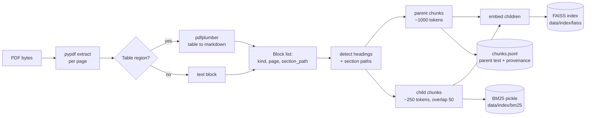

# Architecture: IsipFin

> Design contract. Node names, state fields, table names, and file paths below are **load-bearing**:
> ADRs, `docs/PLAN.md`, `docs/prompts/`, and `docs/REPO-STRUCTURE.md` reference them verbatim.

## System Context

```
┌──────────┐   upload PDFs    ┌────────────────────────────────────────────┐
│  User    │ ───────────────► │  Streamlit UI  (app.py + src/components)    │
│ (analyst)│ ◄─────────────── │  sidebar: model params, sessions, debug     │
└──────────┘   cited answers  └───────────────┬────────────────────────────┘
                                              │ invoke(question, history, params)
                                              ▼
                             ┌───────────────────────────────────────┐
                             │  LangGraph graph  (src/chains/)       │
                             │  contextualize → analyze → route      │
                             │  → retrieve → synthesize → check      │
                             └───┬───────────┬───────────┬───────────┘
                                 │           │           │
                    ┌────────────▼─┐  ┌──────▼─────┐  ┌──▼──────────────┐
                    │ chunking-index│  │ llm-gateway│  │ chat-store      │
                    │ FAISS + BM25  │  │ OpenAI API │  │ SQLite          │
                    │ data/index/*  │  │ (base_url) │  │ data/chat.sqlite│
                    └──────────────┘  └────────────┘  └─────────────────┘
```

## Ingestion Pipeline (offline, per upload)



Invariants: pages are 1-based; every block carries `section_path`; parent linkage is by
`parent_id`; ingestion is **idempotent by content hash** (`doc_id`) — re-uploading the same PDF
rebuilds nothing.

## Query Pipeline (runtime, per question)

```mermaid
flowchart TD
    Q[User question] --> C{Follow-up?}<br/>pronoun / "that" / "it" / ellipsis
    C -- yes --> CTX[contextualize_question<br/>rewrite standalone]
    C -- no --> ANA
    CTX --> ANA[analyze_question<br/>classify + plan, JSON schema]
    ANA --> R{route}
    R -- simple --> RET[hybrid_retrieve]
    R -- multi-part --> DEC[decompose_question]
    R -- out-of-scope / no-docs --> REF[refuse<br/>name coverage gap]
    DEC --> RET
    RET --> RRF[RRF fuse dense+sparse<br/>expand child to parent]
    RRF --> GATE{best fused score<br/>> tau?}
    GATE -- no --> RETRY[rewrite query once<br/>then GR2]
    GATE -- yes --> SYN[synthesize_answer<br/>citation-constrained]
    RETRY --> SYN
    SYN --> NUM[numeric pre-pass<br/>deterministic, no LLM]
    NUM --> VER{groundedness check<br/>LLM + checks.py}
    VER -- fail --> RETRIM[drop unsupported claims<br/>mark ungrounded]
    VER -- pass --> OUT[AnswerEnvelope]
    RETRIM --> OUT
    REF --> OUT
```

### Node Contract Table

| Node | Reads (state) | Writes (state) | LLM? | Notes |
|---|---|---|---|---|
| `contextualize_question` | `question`, `history` | `standalone_question` | yes, cheap model | runs only when follow-up heuristic fires; on LLM error falls back to raw question |
| `analyze_question` | `standalone_question`, `doc_catalog` | `query_plan` | yes, JSON schema | emits `kind ∈ {simple, multi_part, out_of_scope}`, `sub_queries[]`, `required_sections[]` |
| `decompose_question` | `query_plan` | `sub_queries[]` | no (rule-based split of plan) | caps fan-out at 4 sub-queries |
| `hybrid_retrieve` | `sub_queries` (or single question) | `retrieved: list[ScoredChunk]` | no | `retrieve()` per sub-query, RRF merge, top-k parents |
| `synthesize_answer` | `retrieved`, `standalone_question`, `history` | `answer_md`, `citations` | yes | citation-constrained prompt (`docs/prompts/answer-synthesis-with-citations.md`) |
| `groundedness_check` | `answer_md`, `citations` | `grounded`, `refusal_reason` | yes (after deterministic pre-pass) | **Deterministic numeric pre-pass first** (`src/chains/checks.py`): claims whose figure isn't in the cited span, or whose period label contradicts the claim, are rejected and trimmed *without* a model call; the LLM verifier then judges the remaining semantic claims, sent only the context blocks those claims cite (all of them when none cites anything) and reading each verdict back by the `claim_id` the prompt asks for — matching by list position instead re-points a verdict by however many claims the model skipped; schema violation → pessimistic default |
| `refuse` | `query_plan`, `doc_catalog` | `answer_md`, `refusal_reason` | no | honest refusal naming what the docs cover |

Four of seven nodes call the LLM (`contextualize_question`, `analyze_question`,
`synthesize_answer`, `groundedness_check` — the last only after its deterministic pre-pass).
Everything else — topology, edges, retry counting, fan-out cap, score gate, RRF merge, citation
mapping, numeric verification — is symbolic. The full split, why "multi-agent" is the wrong label,
and the deterministic checker's limits are in `docs/adr/ADR-010-neuro-symbolic-pipeline.md`.
Deterministic predicates live in `src/chains/checks.py` (pure, unit-tested, no network).

Routing rules: `out_of_scope` (question about content no uploaded doc covers, per `doc_catalog`
section listing) skips retrieval entirely — no LLM call. Simple queries skip decomposition.
Multi-part queries retrieve once per sub-query (max 4, sequential with the shared gateway
budget). Score gate `tau` (default 0.02 RRF) triggers exactly **one** query rewrite retry, never
an unbounded loop — bounded cost, no infinite retry.

## State Schema (`GraphState`)

```python
class GraphState(TypedDict, total=False):
    # inputs
    question: str
    history: list[Turn]                 # from chat-store
    params: LLMParams
    doc_catalog: list[DocSummary]       # doc_id, filename, section paths — built at ingest
    # intermediate
    standalone_question: str
    query_plan: QueryPlan               # kind, sub_queries, required_sections
    retrieved: list[ScoredChunk]
    retries: int
    # outputs
    answer_md: str
    citations: list[Citation]
    grounded: bool
    refusal_reason: str | None
    # observability (never read by nodes except accretion)
    node_trace: list[NodeEvent]         # node, started_at, ms, tokens_in/out, error
```

Every node wraps its body in the tracing decorator (see `docs/OBSERVABILITY.md`); failures set
`node_trace[-1].error` and raise a typed domain error that `app.py` renders as a user-visible
banner — never an empty answer.

## Data Model

### Files under `data/` (gitignored)

| Path | Content |
|---|---|
| `data/pdfs/<doc_id>.pdf` | uploaded corpus copy |
| `data/index/faiss/` | FAISS vector index for child chunks |
| `data/index/bm25.pkl` | pickled BM25Okapi over child token lists |
| `data/index/chunks.jsonl` | one record per chunk: ids, texts, page, section_path, parent link, scores-free |
| `data/index/docs.jsonl` | `DocSummary` catalog (doc_id, filename, sha256, page_count, sections) |
| `data/chat.sqlite3` | conversation store |

### SQLite schema (ADR-006)

```sql
sessions(id TEXT PK, title TEXT, created_at TEXT, updated_at TEXT, model TEXT)
turns(id INTEGER PK, session_id TEXT REFERENCES sessions, seq INTEGER, role TEXT, -- 'user'|'assistant'
      content TEXT, created_at TEXT, tokens_in INTEGER, tokens_out INTEGER, latency_ms INTEGER)
messages(id INTEGER PK, turn_id INTEGER REFERENCES turns, question TEXT, answer_md TEXT,
         grounded INTEGER, refusal_reason TEXT, node_trace_json TEXT)
citations(id INTEGER PK, message_id INTEGER REFERENCES messages, ref_index INTEGER,
          doc_id TEXT, page INTEGER, section_path TEXT, snippet TEXT)
documents(doc_id TEXT PK, filename TEXT, sha256 TEXT, page_count INTEGER, indexed_at TEXT)
events(id INTEGER PK, session_id TEXT, turn_id INTEGER, ts TEXT, event TEXT, payload_json TEXT)
```

`events` is the observability sink (mirrors what the debug panel reads back for the last answer).
`node_trace_json` keeps the full per-node trace attached to the message that produced it.

## File Ownership (module → path)

| module id | Paths |
|---|---|
| `doc-ingest` | `src/core/pdf_parser.py`, `src/core/tables.py` |
| `chunking-index` | `src/core/chunking.py`, `src/core/index.py`, `src/core/retrieval.py` |
| `llm-gateway` | `src/utils/llm.py`, `src/utils/errors.py`, `src/utils/settings.py` |
| `orchestration` | `src/chains/nodes/*.py`, `src/chains/graph.py`, `src/chains/state.py` |
| `chat-store` | `src/store/db.py`, `src/store/sessions.py` |
| `app-ui` | `app.py`, `src/components/*.py` |
| `packaging` | `Dockerfile`, `docker-compose.yml`, `.github/workflows/ci.yml`, `.env.example` |

## Key Trade-offs (full reasoning in the ADRs)

1. **LangGraph over plain LangChain chains / over bare OpenAI SDK** — explicit state, testable
   nodes, inspectable routing. Cost: one more concept for reviewers. See ADR-001.
2. **Hybrid dense+sparse + parent-child over pure vector** — exact line-item keywords ("Note 13",
   "operating income") need BM25; semantic drift on tables needs parent context. See ADR-002.
3. **Vectorless (tree/PageIndex) rejected** — measured latency + token cost + it violates the
   brief's explicit vector-database requirement. See ADR-003.
4. **SQLite over Postgres/Chroma server** — one-process demo, zero-config Docker, portable. See
   ADR-006/008.
5. **Self-contained Streamlit UI over a FastAPI/React split** — the brief names Streamlit as the
   deliverable; one language surface, and the graph stays importable so an API can be added later
   without touching the pipeline. The honest reason is delivery speed and surface reduction, not
   "Streamlit improves code quality" — the quality comes from the no-logic-in-UI boundary rule.
   See ADR-009.
